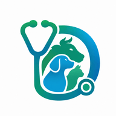

<div align="center">



# DailyVet

**AI-powered animal care and climate-risk platform for Bangladesh**

Early diagnosis, medicine and vet discovery, feed planning, and NASA-backed climate warnings
for livestock, poultry and pet owners.


</div>

---

## Table of Contents

1. [Overview](#overview)
2. [Key Features](#key-features)
3. [Architecture](#architecture)
4. [Tech Stack](#tech-stack)
5. [Project Structure](#project-structure)
6. [Getting Started](#getting-started)
7. [Configuration](#configuration)
8. [Deployment](#deployment)
9. [Security](#security)
10. [Roadmap](#roadmap)
11. [Disclaimer](#disclaimer)
12. [Changelog](#changelog)

---

## Overview

Farmers and pet owners in Bangladesh often lack quick access to a veterinarian, reliable medicine
information, and early warning of climate hazards. DailyVet brings these together in a single,
mobile-first web app that works in **English and Bangla**.

- Describe symptoms in text or upload a photo and get structured guidance from the **AI Doctor**.
- Identify breed, scan prescriptions, droppings and urine, and look up medicines.
- Find and contact registered veterinarians near you.
- Monitor flood, heat-stress, air-quality and disease-outbreak risk using NASA and weather data.
- Compare multi-season crop and forage rotations with the **Field Shift** explorer.

---

## Key Features

### Animal health

| Module | Page | Description |
|---|---|---|
| AI Doctor | `ai.html` | Text and photo consultation for cattle, buffalo, goat, sheep, poultry, ducks, pigeons, dogs, cats, rabbits, fish and other animals. Understands English, Bangla and Banglish. |
| Breed Detection | `breed-detection.html` | Identifies species, breed, sex and visible health signs from a photo, with buying advice. |
| Dung and Urine Test | `excreta-scan.html` | Photo-based screening of droppings and urine for health indicators. |
| Read Prescription | `scanner.html` | Scans prescriptions or medicine documents and explains them in plain language. |
| Find Medicine | `pharma.html` | Medicine lookup by animal and condition. |
| Find a Doctor | `vet-home.html`, `vet-profile.html` | Browse registered vets, call or message on WhatsApp, and discover nearby vets by location. |
| Feed Plan | `advisor.html` | Feed and nutrition guidance. |
| Emergency | `emergency.html` | Emergency help page. |

### Climate and farm risk

| Module | Page |
|---|---|
| NASA Climate Dashboard | `climate-dashboard.html` |
| Division Risk Map | `climate-map.html` |
| Flood Warning | `climate-flood.html` |
| Heat Stress (THI) | `climate-thi.html` |
| Disease Risk Radar | `climate-outbreak.html` |
| Air Quality and UV Warning | `climate-air-quality.html` |
| Forage Plan | `climate-forage.html` |
| Socio-Economic Impact | `climate-impact.html` |
| Field Shift: Rotation Explorer | `rotation-compare.html` |

**Field Shift** compares three multi-season rotations (current path, soil-building, goal-focused)
using soil moisture, NDVI, soil properties, planting window, soil type and risk tolerance, and
produces a printable plan. Scores are relative planning indices, not yield forecasts.

### Platform

- Bilingual interface (English / Bangla) with an accessible language dropdown
- User and vet registration, profiles, community and support center
- Login guard that redirects before protected pages render
- Automatic location detection when permission is already granted
- Installable PWA with service-worker caching

---

## Architecture

```
Browser (static HTML / CSS / vanilla JS, PWA)
   |
   |-- Firebase (Firestore)  ---------------- users, vets, history, community
   |
   |-- /api/ai-proxy  (Vercel)  or  /.netlify/functions/ai-proxy  (Netlify)
   |        |
   |        +-- Gemini  ->  Groq  ->  OpenRouter      (key rotation and fail-over)
   |
   +-- Public data APIs: NASA POWER, MODIS NDVI, SoilGrids, GPM, SEDAC, Open-Meteo
```

---

## Tech Stack

| Layer | Technology |
|---|---|
| Frontend | HTML5, CSS3, vanilla JavaScript (no build step) |
| Data | Firebase Firestore |
| AI | Google Gemini with Groq and OpenRouter fail-over, via a serverless proxy |
| Climate and geo | NASA POWER, MODIS NDVI, SoilGrids, NASA GPM, SEDAC, Open-Meteo, Leaflet, Bangladesh GeoJSON |
| Location | Browser Geolocation, Google Places (optional), LocationIQ |
| Hosting | Vercel or Netlify (serverless functions) |
| PWA | Service worker (`sw.js`) |

---

## Project Structure

```
.
├── index.html, home.html        Landing page and signed-in home
├── *.html                       Feature pages
├── css/                         Stylesheets
├── js/
│   ├── auth.js                  Login, registration, session
│   ├── auth-guard.js            Pre-render login guard
│   ├── ai.js                    AI Doctor logic and prompts
│   ├── breed-detection.js       Breed analysis
│   ├── rotation-compare.js      Field Shift engine
│   ├── crop-knowledge.js        Crop and forage knowledge base
│   ├── location-service.js      Geolocation and nearby vets
│   ├── i18n.js, i18n-bn.js      Translations and language dropdown
│   └── nasa-*.js                NASA data engines
├── api/ai-proxy.js              Vercel serverless AI proxy
├── netlify/functions/           Netlify serverless AI proxy
├── data/                        Bangladesh GeoJSON boundaries
├── assets/                      Images and logo
├── sw.js                        Service worker
├── vercel.json, netlify.toml    Hosting configuration
└── DEPLOY.md                    Detailed deployment guide
```

---

## Getting Started

**Prerequisites:** a modern browser and VS Code with the Live Server extension (or any static server).

```bash
git clone https://github.com/raihanuIR/Daily-vet-v7.0.git
cd Daily-vet-v7.0
```

Open `index.html` with **Live Server**, or serve the folder:

```bash
npx serve .
```

No build or install step is required.

---

## Configuration

Provide AI keys as environment variables in your hosting dashboard.

| Variable | Purpose |
|---|---|
| `GEMINI_KEY_1` ... `GEMINI_KEY_21` | Gemini keys, rotated automatically |
| `GROQ_KEY_1` ... `GROQ_KEY_5` | Groq fail-over keys |
| `OPENROUTER_KEY_1` ... `OPENROUTER_KEY_3` | OpenRouter fail-over keys |

Firebase settings live in `js/firebase-config.js`.

---

## Deployment

| Platform | Steps |
|---|---|
| Vercel | Import the repo, set Framework Preset to **Other**, leave build and output empty. `api/ai-proxy.js` is used automatically. |
| Netlify | Deploy the folder. `netlify.toml` routes `/api/ai-proxy` to the function. |

See [DEPLOY.md](DEPLOY.md) for the full guide.

---

## Security

DailyVet is under active hardening. Current known limitations:

- **Authentication** is phone-number based and the session is stored in the browser. There is no server-verified session yet, so the page guard in `auth-guard.js` improves user experience but is not a security boundary.
- **Firestore rules** must be reviewed and locked down (per-user access by authenticated `uid`, default deny).
- **API keys** must not live in source. Revoke any committed key and use environment variables.
- **AI proxy** should verify a login token, apply rate limits and restrict CORS to the production domain.

A detailed analysis and fix plan is in `DailyVet_Phone_Login_Security_Report.pdf`.

To report a vulnerability, please contact the maintainer privately rather than opening a public issue.

---

## Roadmap

- [ ] Firebase Authentication (Google sign-in and/or phone OTP)
- [ ] Re-key user data by `uid` and migrate existing accounts
- [ ] Per-user Firestore security rules
- [ ] Authenticated, rate-limited AI proxy
- [ ] Vet role through server-side claims
- [ ] Security headers (CSP, HSTS)

---

## Disclaimer

DailyVet provides informational guidance only and is **not** a substitute for a licensed
veterinarian. Medicine choice and dosage must be confirmed by a qualified vet. Climate and
rotation scores are relative planning indices, not yield or outbreak forecasts.

---

## Changelog

### v7.0
- Broader species detection in the AI Doctor (poultry, birds and more) in English and Bangla
- Improved image prompt and wider species support in Breed Detection
- Smarter Field Shift rotation planning (season, soil type, risk tolerance)
- Pre-render login guard and safer logout navigation
- Automatic location detection when permission is granted
- Redesigned language dropdown
- Fixed password show/hide button

---

<div align="center">
Built for farmers and animal lovers of Bangladesh.
</div>
